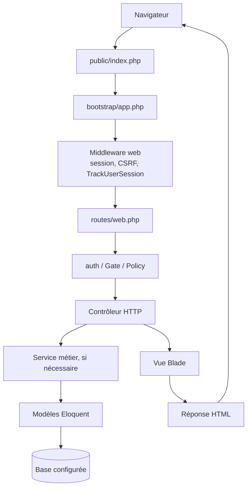
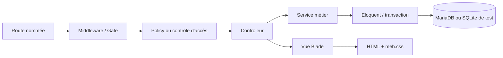
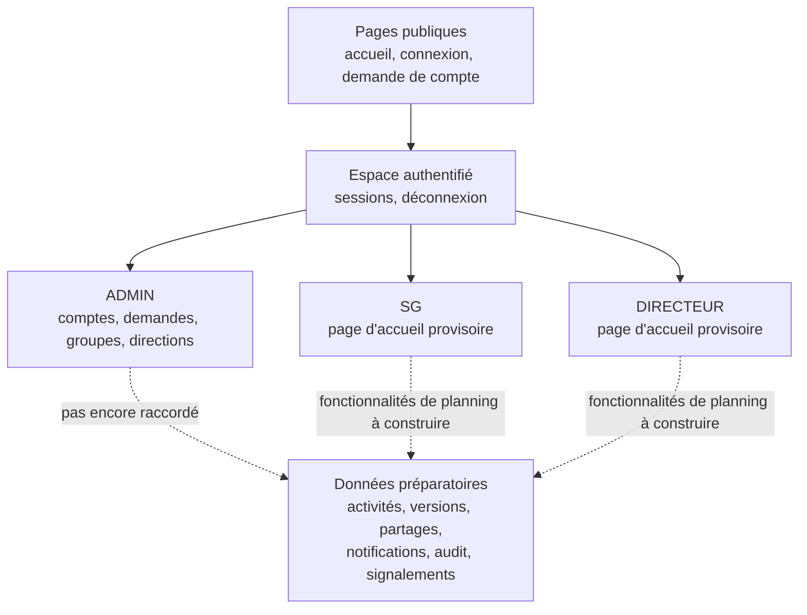
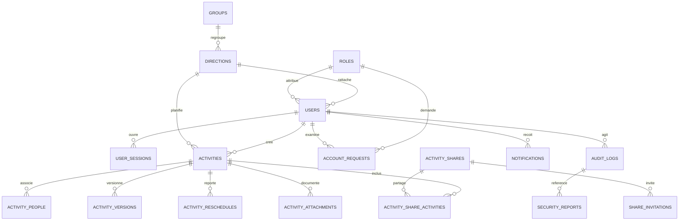

# Guide technique du projet MEH

> **Périmètre du guide :** état du code présent dans le dépôt au moment de l'inspection. Les écrans et l'organisation visuelle sont provisoires et peuvent être remplacés. Les faits observés dans le code sont distingués des intentions du référentiel fonctionnel.

Ce guide est un plan de navigation et d'apprentissage, pas une spécification de toutes les fonctionnalités prévues. Pour comprendre une règle métier, consulter à la fois son implémentation et [directive.md](directive.md), puis vérifier si cette section du référentiel est encore à jour.

## Table des matières

1. [Introduction](#1-introduction)
2. [Comment lire l'état du projet](#2-comment-lire-létat-du-projet)
3. [Architecture générale](#3-architecture-générale)
4. [Cartographie des dossiers et fichiers racine](#4-cartographie-des-dossiers-et-fichiers-racine)
5. [Fonctionnement des couches Laravel](#5-fonctionnement-des-couches-laravel)
6. [Fonctionnalités MEH et niveau d'implémentation](#6-fonctionnalités-meh-et-niveau-dimplémentation)
7. [Modèle de données](#7-modèle-de-données)
8. [Parcours pratiques : où intervenir ?](#parcours-pratiques)
9. [Tests et validation](#9-tests-et-validation)
10. [Configuration et environnements](#10-configuration-et-environnements)
11. [Précautions et points sensibles](#11-précautions-et-points-sensibles)
12. [Glossaire](#12-glossaire)
13. [Index pratique](#13-index-pratique)

## 1. Introduction

MEH est une application Laravel de gestion et de consultation de plannings et d'activités. Le dépôt contient actuellement une application web Blade, des parcours d'authentification, des écrans d'administration et les services de gestion des comptes. Il contient aussi des modèles et une structure de données préparatoires pour les activités, les partages, les notifications et les signalements.

Une table ou un modèle ne signifie pas à lui seul qu'une fonction est accessible aux utilisateurs. Pour confirmer qu'une fonction est opérationnelle, suivre la chaîne complète : route, autorisation, contrôleur, service éventuel, modèle, vue et tests.

Le projet n'est pas figé sur le plan visuel. Avant un changement d'interface important, conserver les protections serveur et les règles métier, mais ne pas considérer la présentation actuelle comme un design définitif.

## 2. Comment lire l'état du projet

Les indications suivantes sont utilisées dans le guide :

- **En place** : un parcours connecté est observable dans les routes et le code associé.
- **Partiel / préparatoire** : les tables, modèles ou règles existent, mais le parcours utilisateur complet n'est pas raccordé.
- **À venir / prototype** : le code est absent, explicitement annoncé comme à venir, ou isolé dans un exemple non relié aux routes.
- **Référentiel** : intention fonctionnelle écrite dans [directive.md](directive.md), pas nécessairement réalisée.

### Écarts entre documents et code

- [README.md](README.md) fournit le démarrage et renvoie vers le référentiel, mais son affirmation selon laquelle la conception de la base resterait à valider ne correspond pas à l'état actuel décrit dans [directive.md](directive.md) ni aux migrations présentes.
- La section d'état de [directive.md](directive.md), datée du 13 novembre 2026, affirme encore que l'authentification et ses routes restent à implémenter. Le dépôt contient maintenant les routes, le contrôleur, le suivi des sessions et des tests associés. Cette section n'a donc pas été actualisée après ces développements.
- Le référentiel décrit des fonctionnalités d'activités et de partage. Dans le code inspecté, ces domaines ont surtout des migrations, des modèles et des policies : aucun contrôleur ni route d'activité, de partage, de notification ou d'audit général n'a été trouvé dans le parcours web actuel.
- La version actuelle de chaque fonctionnalité doit être vérifiée dans le code, et non déduite d'un titre de menu ou d'une table existante.

## 3. Architecture générale

### 3.1 Parcours d'une requête HTTP

Le point d'entrée HTTP est [public/index.php](public/index.php). Il charge l'autoloader Composer, démarre l'application configurée dans [bootstrap/app.php](bootstrap/app.php), puis transmet la requête à Laravel. Les routes web sont définies dans [routes/web.php](routes/web.php).



Le passage par un service est courant pour les règles métier sensibles, par exemple la création d'un compte. Certains contrôleurs d'administration des groupes et directions font actuellement des validations puis écrivent directement via Eloquent. Le diagramme décrit le parcours général, pas une obligation que chaque écran possède un service.

### 3.2 Relations entre les principales couches



La route relie une URL et une méthode HTTP au contrôleur. Le contrôleur valide la requête, vérifie l'autorisation et choisit la suite du traitement. Le service porte une opération métier réutilisable et transactionnelle lorsqu'elle existe. Les modèles Eloquent représentent les données et leurs relations. La vue présente le résultat; elle ne doit pas décider seule des droits.

### 3.3 Organisation fonctionnelle observée



## 4. Cartographie des dossiers et fichiers racine

### 4.1 Racine du dépôt

| Fichier | Rôle et précautions |
|---|---|
| [artisan](artisan) | Lance les commandes Artisan après le chargement de l'autoloader et du bootstrap Laravel. |
| [composer.json](composer.json) / [composer.lock](composer.lock) | Déclarent puis verrouillent les dépendances PHP, les espaces de noms et les scripts Composer. Le script `setup` contient notamment une commande de migration : ne pas le lancer sans avoir vérifié sa cible. |
| [package.json](package.json) / [package-lock.json](package-lock.json) | Déclarent et verrouillent les dépendances front-end et les scripts `dev`/`build`. Aucun script `test` front-end n'est déclaré. |
| [phpunit.xml](phpunit.xml) | Configure PHPUnit, charge [tests/bootstrap.php](tests/bootstrap.php) et force SQLite en mémoire ainsi que les pilotes isolés de test. |
| [vite.config.js](vite.config.js) | Déclare les entrées Vite `app.css`, `meh.css` et `app.js`, ainsi que les plugins Laravel, Tailwind et les polices. |
| [README.md](README.md) | Donne les commandes d'installation et les repères de démarrage. Certaines formulations sur l'état du modèle de données sont anciennes; comparer avec le code et [directive.md](directive.md). |
| [directive.md](directive.md) | Référentiel fonctionnel évolutif. Distingue décisions validées et sujets ouverts, mais son état daté de la section 23 est en partie dépassé par le code actuel. |
| [AGENTS.md](AGENTS.md) | Consignes de développement propres à ce dépôt; à relire avant une nouvelle intervention. |
| [.env.example](.env.example) | Exemple des paramètres d'environnement sans configuration locale réelle. Les valeurs sont lues par les fichiers de [config/](config/). |
| [.env](.env) | Configuration locale ignorée par Git. Elle peut contenir des secrets; ne pas la copier dans un rapport ou un commit et ne pas supposer que ses valeurs correspondent à l'exemple. |
| [.gitignore](.gitignore) | Exclut notamment `.env`, `vendor`, `node_modules`, les journaux et les artefacts compilés. |
| [.editorconfig](.editorconfig), [.gitattributes](.gitattributes), [.npmrc](.npmrc) | Définissent respectivement des conventions d'édition, des attributs Git et la politique d'installation NPM (`ignore-scripts=true`). |
| [boost.json](boost.json) | Configuration de l'intégration Laravel Boost. Ce n'est pas la configuration fonctionnelle de l'application. |

### 4.2 Code PHP de l'application

#### Entrée HTTP, contrôleurs et middleware

| Fichier | Fonction concrète et limites |
|---|---|
| [bootstrap/app.php](bootstrap/app.php) | Déclare [routes/web.php](routes/web.php), la route de santé `/up`, les alias `role`/`direction`, et ajoute `TrackUserSession` au groupe web. C'est l'équivalent de configuration du noyau Laravel dans cette version du framework. |
| [bootstrap/providers.php](bootstrap/providers.php) | Enregistre `AppServiceProvider`. |
| [app/Http/Controllers/Controller.php](app/Http/Controllers/Controller.php) | Contrôleur de base qui active `AuthorizesRequests`, utilisé par les contrôleurs applicatifs. |
| [app/Http/Controllers/Auth/AuthenticatedSessionController.php](app/Http/Controllers/Auth/AuthenticatedSessionController.php) | Affiche le formulaire de connexion et la liste des sessions de l'utilisateur, traite la connexion, la révocation d'une de ses sessions et la déconnexion courante. Il utilise `UserSessionService`. |
| [app/Http/Controllers/AccountRequestController.php](app/Http/Controllers/AccountRequestController.php) | Prépare le formulaire public à partir des rôles et directions existants, valide la soumission et délègue à `AccountRequestService`. Le rôle ADMIN n'est pas demandé par la voie publique. |
| [app/Http/Controllers/Admin/AccountRequestController.php](app/Http/Controllers/Admin/AccountRequestController.php) | Recherche/filtre les demandes, affiche leur détail et délègue approbation/refus au service métier. Ces décisions sont dans les routes de demandes, pas dans la gestion des utilisateurs. |
| [app/Http/Controllers/Admin/UserController.php](app/Http/Controllers/Admin/UserController.php) | Liste et filtre les utilisateurs, affiche leurs détails et appelle `UserAccountService` pour créer, modifier, activer, désactiver ou révoquer toutes leurs sessions. |
| [app/Http/Controllers/Admin/GroupController.php](app/Http/Controllers/Admin/GroupController.php) | Affiche, crée et modifie les groupes. Les routes l'entourent d'un contrôle `auth` et `can:admin`; il n'y a pas d'action de suppression. Les écritures ne passent pas par un service dédié. |
| [app/Http/Controllers/Admin/DirectionController.php](app/Http/Controllers/Admin/DirectionController.php) | Affiche, crée et modifie les directions et leur groupe; les données sont validées puis écrites par Eloquent. Pas de suppression ni de service dédié actuellement. |
| [app/Http/Middleware/EnsureRole.php](app/Http/Middleware/EnsureRole.php) | Refuse l'accès si l'utilisateur n'a pas un des codes de rôle demandés. Alias enregistré sous `role`. |
| [app/Http/Middleware/EnsureDirectionAccess.php](app/Http/Middleware/EnsureDirectionAccess.php) | Résout une direction depuis les paramètres de route/requête, puis vérifie la consultation ou la gestion selon le paramètre. Alias enregistré sous `direction`. |
| [app/Http/Middleware/TrackUserSession.php](app/Http/Middleware/TrackUserSession.php) | Vérifie pour chaque requête web authentifiée qu'un enregistrement actif correspond au hash de la session et que le compte est actif; actualise ensuite l'activité. Une session révoquée est bloquée à sa prochaine requête, pas nécessairement instantanément pendant son inactivité. |
| [app/Http/Controllers/ExerciceConnexionControlller.php](app/Http/Controllers/ExerciceConnexionControlller.php) | Prototype de connexion séparé basé sur `ExerciceCompte`. Il n'est pas raccordé aux routes actuelles et contient une règle de validation mal orthographiée (`requierd`); ne pas le prendre pour l'authentification MEH. |

#### Services métier

| Fichier | Responsabilité et données produites |
|---|---|
| [app/Services/AccountRequestService.php](app/Services/AccountRequestService.php) | Crée une demande publique, contrôle les rôles SG/DIRECTEUR et les doublons, approuve ou refuse avec transaction, crée le compte accepté et écrit les événements d'audit. Vérifier ce service avant de modifier le workflow de demande. |
| [app/Services/UserAccountService.php](app/Services/UserAccountService.php) | Source de vérité des règles de compte: cohérence rôle/direction, unicité d'un directeur actif par direction, protection du dernier ADMIN actif, hashage, audit, activation/désactivation et révocation globale. Les contrôleurs ne doivent pas contourner ces règles. |
| [app/Services/DirectorAssignmentService.php](app/Services/DirectorAssignmentService.php) | Verrouille les lignes de directions en ordre stable et garantit qu'une direction n'a pas deux directeurs actifs lors des écritures transactionnelles concernées. |
| [app/Services/UserSessionService.php](app/Services/UserSessionService.php) | Enregistre les sessions avec SHA-256 de l'identifiant, repère l'enregistrement de la session courante, actualise l'activité et marque une ou toutes les sessions comme révoquées sans effacer l'historique. |
| [app/Services/AccountAuditService.php](app/Services/AccountAuditService.php) | Ajoute une ligne `audit_logs` avec acteur, action, ressource et détails JSON. Les services de compte et de demande l'appellent dans leurs transactions. |
| [app/Services/NotificationService.php](app/Services/NotificationService.php) | **Anomalie de nommage/contenu :** ce fichier déclare `App\Models\UserNotification`, et non une classe `NotificationService`. Il duplique le contenu de [app/Models/UserNotification.php](app/Models/UserNotification.php). Aucun service de notification réellement nommé `NotificationService` n'est confirmé par le code. |

#### Modèles et règles d'accès

| Fichier | Rôle, relations ou précautions |
|---|---|
| [app/Models/User.php](app/Models/User.php) | Modèle d'authentification; relations au rôle, à la direction, aux sessions et aux demandes; tests `isAdmin`, `isSg`, `isDirector`, `isActive` et contrôle d'accès aux directions. Cache le mot de passe et `remember_token`; le cast `hashed` protège les écritures de mot de passe. |
| [app/Models/Role.php](app/Models/Role.php) | Définit les constantes applicatives `ADMIN`, `SG`, `DIRECTEUR` et les relations aux utilisateurs/demandes. |
| [app/Models/Group.php](app/Models/Group.php) | Groupe organisationnel, relation `directions()`. |
| [app/Models/Direction.php](app/Models/Direction.php) | Appartient à un groupe et référence ses utilisateurs/activités; relaie les contrôles d'accès au modèle utilisateur. |
| [app/Models/AccountRequest.php](app/Models/AccountRequest.php) | Demande en attente ou traitée, relations vers rôle demandé, direction, réviseur et compte créé. Le mot de passe est caché et hashé par cast. |
| [app/Models/UserSession.php](app/Models/UserSession.php) | Registre des sessions, avec dates castées et hash de session caché lors de la sérialisation. |
| [app/Models/Activity.php](app/Models/Activity.php) | Activité associée à une direction et à son créateur; relations aux personnes, versions, reports et pièces jointes; utilise `SoftDeletes`. Cela ne rend pas à lui seul les écrans d'activité opérationnels. |
| [app/Models/ActivityPerson.php](app/Models/ActivityPerson.php) | Participant lié à une activité et éventuellement à un compte MEH. |
| [app/Models/ActivityVersion.php](app/Models/ActivityVersion.php) | Snapshot JSON versionné d'une activité et référence à l'auteur du changement. |
| [app/Models/ActivityReschedule.php](app/Models/ActivityReschedule.php) | Anciennes et nouvelles dates d'un report, son motif et l'utilisateur responsable. |
| [app/Models/ActivityShare.php](app/Models/ActivityShare.php) | Partage créé par un utilisateur, relation plusieurs-à-plusieurs aux activités via `activity_share_activities`, et invitations associées. |
| [app/Models/ShareInvitation.php](app/Models/ShareInvitation.php) | Invitation à un partage; le hash du jeton est caché; relation au partage, à l'invitant et aux notifications. |
| [app/Models/ActivityAttachment.php](app/Models/ActivityAttachment.php) | Métadonnées de pièce jointe et relations à l'activité et à l'utilisateur déposant; ne met pas en œuvre à lui seul l'envoi ou le téléchargement sécurisé de fichiers. |
| [app/Models/Notification.php](app/Models/Notification.php) | Modèle direct de `notifications`, sans suppression logique Eloquent. |
| [app/Models/UserNotification.php](app/Models/UserNotification.php) | Autre représentation de `notifications`, avec `SoftDeletes` et création automatique de `created_at`; utilisée par les relations de `User`. Examiner soigneusement la différence avant toute évolution. |
| [app/Models/AuditLog.php](app/Models/AuditLog.php) | Représente une trace d'audit et son acteur; expose aussi la relation aux signalements. Le modèle seul n'impose pas l'immutabilité au niveau SQL. |
| [app/Models/SecurityReport.php](app/Models/SecurityReport.php) | Données d'un signalement et ses relations à l'auteur, à l'utilisateur concerné, à la trace d'audit et au résolveur. Aucun workflow web de traitement n'est raccordé. |
| [app/Models/ExerciceCompte.php](app/Models/ExerciceCompte.php) | Compte de l'exercice pédagogique séparé de `users`; cache son mot de passe. À ne pas confondre avec un compte MEH. |
| [app/Policies/UserPolicy.php](app/Policies/UserPolicy.php) | Règles d'accès sur les utilisateurs, dont activation, désactivation et révocation de sessions; les routes d'administration ajoutent aussi `auth` et `can:admin`. |
| [app/Policies/AccountRequestPolicy.php](app/Policies/AccountRequestPolicy.php) | Réserve la consultation administrative et les décisions à ADMIN; approbation/refus permis seulement lorsque la demande est `PENDING`. |
| [app/Policies/DirectionPolicy.php](app/Policies/DirectionPolicy.php) | Règles de consultation/gestion de direction suivant les capacités de l'utilisateur. |
| [app/Policies/ActivityPolicy.php](app/Policies/ActivityPolicy.php) | Règles préparatoires de consultation/édition d'activité, incluant la séparation par direction. Aucune route d'activité ne l'appelle actuellement. |
| [app/Providers/AppServiceProvider.php](app/Providers/AppServiceProvider.php) | Enregistre les quatre policies et les Gates `admin`, `sg`, `director`, `view-direction`, `manage-direction`, `access-direction`. |

### 4.3 Routes, bootstrap et configuration Laravel

| Fichier | Ce qu'il règle |
|---|---|
| [routes/web.php](routes/web.php) | Routes web nommées pour l'accueil public, connexion, demandes publiques, sessions, déconnexion, redirection par rôle, espaces SG/DIRECTEUR et administration ADMIN. Les approbations/refus sont exclusivement dans la section des demandes. Aucune route API ou d'activité n'est déclarée. |
| [routes/console.php](routes/console.php) | Contient uniquement la commande Artisan d'exemple `inspire`. |
| [config/auth.php](config/auth.php) | Guard web basé sur session et provider Eloquent `User`; configure le broker de récupération de mot de passe, mais aucune route de récupération n'est actuellement enregistrée. |
| [config/database.php](config/database.php) | Connexions SQLite, MySQL/MariaDB, PostgreSQL et SQL Server; connexion par défaut pilotée par `DB_CONNECTION`. Ne contient pas les valeurs locales effectives de `.env`. |
| [config/session.php](config/session.php) | Driver par défaut `file`, durée de secours 10 080 minutes, cookie et répertoire de stockage. La valeur effective peut être remplacée par l'environnement. |
| [config/meh.php](config/meh.php) | Regroupe les quatre paramètres `MEH_ADMIN_*` dans `meh.initial_admin`; ne contient pas leurs valeurs locales. |
| [config/navigation.php](config/navigation.php) | Menus associés aux trois codes de rôle; l'entrée de journaux ADMIN est marquée « À venir ». Le menu n'est pas une barrière d'autorisation. |
| [config/app.php](config/app.php) | Nom, environnement, fuseau UTC, locale, clé de chiffrement et mode maintenance. La locale de secours est anglaise alors que les vues ont `lang="fr"`. |
| [config/cache.php](config/cache.php) | Pilotes de cache, dont `array`, `database` et `file`. |
| [config/queue.php](config/queue.php) | Pilotes de file et tables/jobs. Les tests utilisent une file synchrone. |
| [config/mail.php](config/mail.php) | Mailers configurables; l'exemple utilise le journal. Aucun flux de notification métier par courriel n'est raccordé. |
| [config/filesystems.php](config/filesystems.php) | Disques local/public/S3 et lien `public/storage`; ne constitue pas un workflow de pièces jointes d'activité. |
| [config/logging.php](config/logging.php) | Canaux Monolog et emplacement des journaux sous [storage/logs/](storage/logs/). |
| [config/services.php](config/services.php) | Paramètres génériques de fournisseurs tiers, pris depuis l'environnement. |

<a id="migrations-seeders"></a>

### 4.4 Base de données : migrations, seeders et factory

Les migrations définissent les tables et contraintes; elles ne décrivent pas à elles seules le comportement des écrans. Toutes les clés étrangères métier observées sont configurées pour empêcher la suppression de lignes référencées (`restrictOnDelete`).

| Migration | Schéma créé |
|---|---|
| [database/migrations/0001_01_01_000001_create_cache_table.php](database/migrations/0001_01_01_000001_create_cache_table.php) | Tables `cache` et `cache_locks` de Laravel. |
| [database/migrations/0001_01_01_000002_create_jobs_table.php](database/migrations/0001_01_01_000002_create_jobs_table.php) | Tables `jobs`, `job_batches` et `failed_jobs`. |
| [database/migrations/2026_11_11_112932_create_groups_table.php](database/migrations/2026_11_11_112932_create_groups_table.php) | `groups`, avec nom unique. |
| [database/migrations/2026_11_11_112933_create_directions_table.php](database/migrations/2026_11_11_112933_create_directions_table.php) | `directions`, groupe obligatoire, code éventuellement unique, nom unique au sein du groupe. |
| [database/migrations/2026_11_11_112938_create_roles_table.php](database/migrations/2026_11_11_112938_create_roles_table.php) | `roles`, code unique. |
| [database/migrations/2026_11_11_140000_create_users_table.php](database/migrations/2026_11_11_140000_create_users_table.php) | `users` et `password_reset_tokens`. `remember_token` est déjà déclaré ici. |
| [database/migrations/2026_11_12_130000_create_account_requests_table.php](database/migrations/2026_11_12_130000_create_account_requests_table.php) | `account_requests`, candidat, rôle/direction demandés, statut, décision et compte éventuellement créé. |
| [database/migrations/2026_11_12_130001_create_user_sessions_table.php](database/migrations/2026_11_12_130001_create_user_sessions_table.php) | `user_sessions`, hash, appareil, OS, état et dates de connexion/activité/révocation. |
| [database/migrations/2026_11_12_130002_create_activities_table.php](database/migrations/2026_11_12_130002_create_activities_table.php) | `activities`, propriétaire directionnel, dates, brouillon/statut, archivage et suppression logique. |
| [database/migrations/2026_11_12_130003_create_activity_people_table.php](database/migrations/2026_11_12_130003_create_activity_people_table.php) | `activity_people`, participants liés ou non à un compte. |
| [database/migrations/2026_11_12_130004_create_activity_versions_table.php](database/migrations/2026_11_12_130004_create_activity_versions_table.php) | `activity_versions`, snapshot JSON et unicité activité/numéro de version. |
| [database/migrations/2026_11_12_130005_create_activity_reschedules_table.php](database/migrations/2026_11_12_130005_create_activity_reschedules_table.php) | `activity_reschedules`, horaires avant/après et raison. |
| [database/migrations/2026_11_12_130006_create_activity_shares_table.php](database/migrations/2026_11_12_130006_create_activity_shares_table.php) | `activity_shares`, créateur, portée, dates et statut. |
| [database/migrations/2026_11_12_130007_create_activity_share_activities_table.php](database/migrations/2026_11_12_130007_create_activity_share_activities_table.php) | Table pivot des activités liées à un partage. |
| [database/migrations/2026_11_12_130008_create_share_invitations_table.php](database/migrations/2026_11_12_130008_create_share_invitations_table.php) | `share_invitations`, destinataire, statut, hash de jeton, expiration/acceptation. |
| [database/migrations/2026_11_12_130010_create_activity_attachments_table.php](database/migrations/2026_11_12_130010_create_activity_attachments_table.php) | `activity_attachments`, métadonnées et chemin de stockage. |
| [database/migrations/2026_11_12_130011_create_notifications_table.php](database/migrations/2026_11_12_130011_create_notifications_table.php) | `notifications`, destinataire, acteur, activité/invitation, contenu et dates de lecture/suppression. |
| [database/migrations/2026_11_12_130012_create_audit_logs_table.php](database/migrations/2026_11_12_130012_create_audit_logs_table.php) | `audit_logs`, acteur, action, ressource, détails, IP et appareil. |
| [database/migrations/2026_11_12_130013_create_security_reports_table.php](database/migrations/2026_11_12_130013_create_security_reports_table.php) | `security_reports`, auteur, sujet, trace liée, catégorie, statut et résolution. |
| [database/migrations/2026_11_15_154933_create_exercice_comptes_table.php](database/migrations/2026_11_15_154933_create_exercice_comptes_table.php) | `exercice_comptes`, table séparée du système d'utilisateurs MEH. |

| Seeder/factory | Rôle et précaution |
|---|---|
| [database/seeders/DatabaseSeeder.php](database/seeders/DatabaseSeeder.php) | Orchestre `RoleSeeder`, `GroupSeeder`, `DirectionSeeder`, puis `AdminUserSeeder`. Le lancer écrit dans la base sélectionnée. |
| [database/seeders/RoleSeeder.php](database/seeders/RoleSeeder.php) | Crée seulement ADMIN, SG et DIRECTEUR via `firstOrCreate`; ne remplace pas les libellés existants et est idempotent. Aucun rôle CHEF_SERVICE. |
| [database/seeders/GroupSeeder.php](database/seeders/GroupSeeder.php) / [database/seeders/DirectionSeeder.php](database/seeders/DirectionSeeder.php) | Ne créent actuellement aucune donnée organisationnelle. |
| [database/seeders/AdminUserSeeder.php](database/seeders/AdminUserSeeder.php) | Crée un premier ADMIN seulement si aucun ADMIN n'existe, depuis `MEH_ADMIN_NAME`, `MEH_ADMIN_FIRSTNAME`, `MEH_ADMIN_EMAIL`, `MEH_ADMIN_PASSWORD`; valide les champs, exige 12 caractères de mot de passe, s'appuie sur le cast hashé de `User` et journalise la création. Il ne modifie pas un ADMIN déjà présent. |
| [database/seeders/ExerciceCompteSeeder.php](database/seeders/ExerciceCompteSeeder.php) | Seeder de prototype avec des données d'exercice inscrites dans le code; il n'est pas appelé par `DatabaseSeeder`. Ne pas le lancer dans une base réelle. |
| [database/factories/UserFactory.php](database/factories/UserFactory.php) | Factory Laravel de base. Elle ne renseigne pas tous les champs métier obligatoires présents dans `users`; vérifier ses besoins avant de l'utiliser telle quelle pour fabriquer un utilisateur de test. |

### 4.5 Interface, ressources et vues

L'interface web principale est rendue avec Blade. Les vues partagées sont des composants Blade simples; aucun composant Livewire ni attribut `wire:` n'a été trouvé dans les vues actuelles.

| Fichier(s) | Rôle et moment d'intervention |
|---|---|
| [resources/views/components/layouts/app.blade.php](resources/views/components/layouts/app.blade.php) | Layout authentifié : déduit le rôle, charge le menu, affiche sidebar, barre supérieure, titre de page et contenu enfant. Il charge `meh.css`. |
| [resources/views/components/layouts/public.blade.php](resources/views/components/layouts/public.blade.php) | Layout public, en français, avec navigation accueil/connexion/demande et `meh.css`. |
| [resources/views/components/app/sidebar.blade.php](resources/views/components/app/sidebar.blade.php), [resources/views/components/app/topbar.blade.php](resources/views/components/app/topbar.blade.php), [resources/views/components/app/navigation.blade.php](resources/views/components/app/navigation.blade.php) | Barre latérale, identité utilisateur/déconnexion, navigation selon [config/navigation.php](config/navigation.php); les liens de menu ne remplacent pas les protections des routes. |
| [resources/views/components/app/page-header.blade.php](resources/views/components/app/page-header.blade.php) | Présentation commune du titre, du descriptif et du surtitre d'une page authentifiée. |
| [resources/views/components/form/field.blade.php](resources/views/components/form/field.blade.php), [resources/views/components/form/errors.blade.php](resources/views/components/form/errors.blade.php), [resources/views/components/ui/status-message.blade.php](resources/views/components/ui/status-message.blade.php) | Champ réutilisable avec erreur, résumé des validations et message flash de résultat. |
| [resources/views/welcome.blade.php](resources/views/welcome.blade.php) | Accueil public avec liens nommés vers connexion et demande de compte. |
| [resources/views/auth/login.blade.php](resources/views/auth/login.blade.php) | Formulaire de connexion avec jeton CSRF, identifiants et option « se souvenir de moi ». |
| [resources/views/auth/sessions.blade.php](resources/views/auth/sessions.blade.php) | Tableau des sessions du compte connecté et révocation d'une session distante appartenant à ce même compte. Vue actuellement autonome, non habillée par le layout partagé; son texte d'état comporte un libellé anglais résiduel. |
| [resources/views/account-requests/create.blade.php](resources/views/account-requests/create.blade.php) | Formulaire public de demande, choix des rôles exposés par le contrôleur, direction dynamique requise côté navigateur pour DIRECTEUR; la validation serveur reste déterminante. |
| [resources/views/dashboard/role-home.blade.php](resources/views/dashboard/role-home.blade.php) | Page d'accueil provisoire commune au SG et au DIRECTEUR; annonce que leurs modules seront ajoutés progressivement. |
| [resources/views/admin/dashboard.blade.php](resources/views/admin/dashboard.blade.php) | Tableau de bord ADMIN et liens vers les modules disponibles; journaux d'activité annoncés comme à venir. |
| [resources/views/admin/account-requests/index.blade.php](resources/views/admin/account-requests/index.blade.php) / [resources/views/admin/account-requests/show.blade.php](resources/views/admin/account-requests/show.blade.php) | Liste filtrable, détail/historique, actions de décision visibles seulement pour une demande en attente, confirmations explicites et motif optionnel de refus. |
| [resources/views/admin/users/index.blade.php](resources/views/admin/users/index.blade.php), [resources/views/admin/users/show.blade.php](resources/views/admin/users/show.blade.php) | Liste avec recherche, filtres, pagination, actions par état; fiche avec nombre de sessions actives et actions d'administration. |
| [resources/views/admin/users/_form.blade.php](resources/views/admin/users/_form.blade.php), [resources/views/admin/users/create.blade.php](resources/views/admin/users/create.blade.php), [resources/views/admin/users/edit.blade.php](resources/views/admin/users/edit.blade.php) | Formulaire partagé de création/modification, champs du compte, sélection rôle/direction et mot de passe optionnel à la modification. Les règles JavaScript d'affichage ne remplacent pas la validation métier. |
| [resources/views/admin/groups/index.blade.php](resources/views/admin/groups/index.blade.php), [resources/views/admin/groups/_form.blade.php](resources/views/admin/groups/_form.blade.php), [resources/views/admin/groups/create.blade.php](resources/views/admin/groups/create.blade.php), [resources/views/admin/groups/edit.blade.php](resources/views/admin/groups/edit.blade.php) | Écrans ADMIN de consultation, création et modification des groupes; pas de suppression. |
| [resources/views/admin/directions/index.blade.php](resources/views/admin/directions/index.blade.php), [resources/views/admin/directions/_form.blade.php](resources/views/admin/directions/_form.blade.php), [resources/views/admin/directions/create.blade.php](resources/views/admin/directions/create.blade.php), [resources/views/admin/directions/edit.blade.php](resources/views/admin/directions/edit.blade.php) | Écrans ADMIN de consultation, création et modification des directions/groupe de rattachement; pas de suppression. |
| [resources/views/administrateur.blade.php](resources/views/administrateur.blade.php), [resources/views/exercice/connexion.blade.php](resources/views/exercice/connexion.blade.php) | Vues vides ou prototypes historiques, sans route fonctionnelle actuelle; ne pas prendre comme écrans d'administration ou d'authentification en service. |
| [resources/css/meh.css](resources/css/meh.css) | Feuille de style centralisée de l'interface actuelle : structure, formulaires, tableaux, états et adaptations responsive. C'est le fichier CSS principal des layouts partagés. |
| [resources/css/app.css](resources/css/app.css) | Point d'entrée Tailwind CSS 4. Il est compilé par Vite, mais les layouts partagés consultés ne le chargent pas; la vue historique `administrateur.blade.php` est la seule à le référencer avec le JavaScript. |
| [resources/js/app.js](resources/js/app.js) | Initialise FullCalendar seulement si `#calendar` existe; importe les vues mois/semaine/jour/liste et la locale française, avec `events: []`. Aucun calendrier MEH alimenté en activités n'est actuellement raccordé. |
| [public/index.php](public/index.php), [public/.htaccess](public/.htaccess) | Entrée HTTP et règles de réécriture Apache vers le front controller. |
| [public/build/](public/build/), [node_modules/](node_modules/), [vendor/](vendor/), [storage/](storage/) | Répertoires générés/dépendances/données d'exécution. Ne pas modifier à la main pour faire évoluer le code; reconstruire les assets avec Vite et conserver les données de [storage/](storage/). |

Les manifestes déclarent Livewire, Tailwind CSS et FullCalendar. Dans les vues observées, les écrans sont rendus par Blade traditionnel; Tailwind n'est pas importé par les layouts partagés, `app.js` n'est pas chargé par ces layouts, et aucune dépendance/import Alpine n'a été repérée. La présence d'un paquet ne prouve donc pas son usage dans une fonctionnalité courante.

### 4.6 Tests

| Fichier | Couverture principale |
|---|---|
| [tests/TestCase.php](tests/TestCase.php) / [tests/bootstrap.php](tests/bootstrap.php) | Démarrage Laravel pour les tests; refus explicite d'une connexion non SQLite en mémoire, restriction des connexions disponibles et migrations de test isolées. |
| [tests/Feature/TestingDatabaseIsolationTest.php](tests/Feature/TestingDatabaseIsolationTest.php) | Confirme le schéma SQLite attendu, la persistance du PDO entre créations d'application et le rollback transactionnel. |
| [tests/Feature/DashboardAccessTest.php](tests/Feature/DashboardAccessTest.php) | Accès au tableau ADMIN, refus aux autres rôles, redirection vers les espaces, pages publiques et déconnexion limitée à la session courante. |
| [tests/Feature/UserSessionAuthenticationTest.php](tests/Feature/UserSessionAuthenticationTest.php) | Connexion, invalidité des identifiants, création/hash, suivi/rejet d'une session révoquée, liste et révocation limitée aux sessions du compte. |
| [tests/Feature/D5AccountManagementTest.php](tests/Feature/D5AccountManagementTest.php) | Demandes et décisions, gestion des comptes, unicité de l'affectation DIRECTEUR, sessions lors de la désactivation, et traces d'audit sans informations d'identification. |
| [tests/Feature/AdminAccountWorkspaceTest.php](tests/Feature/AdminAccountWorkspaceTest.php) | Filtres/détails des demandes et utilisateurs, confidentialité, actions de compte, déconnexion forcée et refus des rôles non ADMIN. |
| [tests/Feature/AdminGroupDirectionTest.php](tests/Feature/AdminGroupDirectionTest.php) | CRUD autorisé (création/modification/lecture), validation, unicité et accès ADMIN aux groupes et directions. |
| [tests/Feature/PublicAccountRequestDirectionTest.php](tests/Feature/PublicAccountRequestDirectionTest.php) | Rôles publics, choix des directions, cas DIRECTEUR sans direction, et refus d'une demande ADMIN forgée. |
| [tests/Feature/AdminUserSeederTest.php](tests/Feature/AdminUserSeederTest.php), [tests/Feature/DatabaseSeederTest.php](tests/Feature/DatabaseSeederTest.php), [tests/Feature/RoleSeederTest.php](tests/Feature/RoleSeederTest.php), [tests/Feature/GroupSeederTest.php](tests/Feature/GroupSeederTest.php), [tests/Feature/DirectionSeederTest.php](tests/Feature/DirectionSeederTest.php) | Contrats du seeder ADMIN initial, orchestration, rôles système, et absence de données d'organisation artificielles. |
| [tests/Feature/AuthorizationAccessTest.php](tests/Feature/AuthorizationAccessTest.php) | Règles de rôles et séparation des directions, y compris les checks des policies Activity/Direction. |
| [tests/Feature/ExampleTest.php](tests/Feature/ExampleTest.php), [tests/Unit/ExampleTest.php](tests/Unit/ExampleTest.php) | Tests Laravel/PHPUnit d'exemple; à distinguer des scénarios métier dédiés. |

## 5. Fonctionnement des couches Laravel

### Routes

Une route associe une méthode HTTP et un chemin à une action, puis lui donne un nom réutilisable. Les appels Blade comme `route('admin.users.show', $user)` évitent de recopier les chemins d'URL. Dans MEH, Les routes web actuelles sont toutes dans [routes/web.php](routes/web.php); il n'y a pas de fichier API observé.

### Middleware

Un middleware s'exécute avant/après la logique de route. Laravel fournit notamment `web`, `guest` et `auth`; MEH ajoute les alias `role` et `direction`, ainsi que `TrackUserSession` à toutes les requêtes web. Une page protégée ne doit pas être rendue publique simplement parce que son lien a disparu du menu.

### Contrôleurs

Les contrôleurs traduisent la requête HTTP en opération applicative. Dans [app/Http/Controllers/Admin/UserController.php](app/Http/Controllers/Admin/UserController.php), par exemple, une modification est validée, autorisée, transmise au service de compte, puis redirigée avec un message flash. Éviter d'y recopier des règles métier déjà dans un service.

### Policies et Gates

Un Gate répond à une capacité nommée, par exemple `admin`. Une Policy regroupe les décisions sur un type de ressource, par exemple « cet ADMIN peut-il révoquer les sessions de cet utilisateur ? ». [AppServiceProvider](app/Providers/AppServiceProvider.php) enregistre ces contrôles. Le contrôleur appelle `authorize`, tandis que Blade peut masquer une action avec `@can`; le contrôle serveur reste obligatoire.

### Services

Un service rassemble une opération métier qui peut servir à plusieurs points d'entrée et qui doit rester cohérente en transaction. MEH utilise notamment `AccountRequestService`, `UserAccountService`, `UserSessionService`, `DirectorAssignmentService` et `AccountAuditService`. Avant d'ajouter un service, vérifier si l'opération appartient déjà à l'un de ceux-ci.

### Modèles Eloquent

Un modèle relie une classe PHP à une table et expose des relations. Par exemple, `Direction::group()` permet d'obtenir son groupe, tandis que `Group::directions()` renvoie les directions rattachées. Les casts, champs cachés et relations influencent aussi l'authentification et les réponses; une modification de modèle doit être couverte par un test.

### Migrations et seeders

Une migration fait évoluer le schéma; son `up()` applique une transformation et son `down()` la décrit à rebours. La table `migrations` enregistre ce qui a été appliqué sur une base. Ne jamais éditer une migration déjà partagée/appliquée pour changer le schéma : créer une nouvelle migration seulement après validation du besoin et sauvegarde appropriée.

Un seeder insère des données initiales. Le seeder ADMIN lit des secrets depuis l'environnement et écrit aussi une trace d'audit; l'exécuter n'est pas une opération de lecture. Les seeders de groupes et directions sont volontairement vides.

### Vues Blade, composants et layouts

Une vue Blade produit du HTML à partir des données fournies par le contrôleur. Les layouts définissent la structure commune et `{{ $slot }}` reçoit le contenu enfant. Les composants `x-form.field` et `x-ui.status-message` réduisent la duplication, mais ne valident pas les données serveur.

Les formulaires de modification doivent inclure le jeton CSRF (`@csrf`). Pour les méthodes non prises en charge nativement par HTML, Blade simule PUT/PATCH avec `@method`. Le code d'affichage ne doit jamais exposer de hash de session ou de mot de passe.

### CSS, JavaScript et Vite

Vite compile les entrées listées dans [vite.config.js](vite.config.js), puis `@vite` charge les fichiers construits. `meh.css` porte actuellement la présentation des layouts partagés. `app.js` initialise un calendrier vide si un élément `#calendar` existe; aucune gestion d'activités n'envoie actuellement des événements à ce calendrier.

### Configuration

Les fichiers de [config/](config/) donnent des valeurs par défaut et lisent les variables d'environnement avec `env()`. En fonctionnement, Laravel met cette configuration en cache; les commandes de cache peuvent donc être nécessaires après un changement d'environnement, mais ne doivent pas être confondues avec une modification du code métier. Ne pas publier de valeur secrète de [`.env`](.env).

## 6. Fonctionnalités MEH et niveau d'implémentation

| Domaine | Code réellement raccordé | Ce qui reste à distinguer |
|---|---|---|
| Authentification | Connexion/déconnexion par guard web, vérification du statut `ACTIVE`, mise à jour de `last_login`; routes dans [routes/web.php](routes/web.php) et contrôleur [AuthenticatedSessionController](app/Http/Controllers/Auth/AuthenticatedSessionController.php). | Pas de routes observées pour oubli/réinitialisation de mot de passe, vérification d'adresse, verrouillage après cinq échecs ou 2FA. Le broker existe dans la configuration seulement. |
| Sessions | Registre `user_sessions`, hash SHA-256, mise à jour à chaque requête web authentifiée, liste/révocation personnelle, révocation globale ADMIN et conservation des lignes historiques. | L'interruption d'une session distante inactive se produit lors de sa prochaine requête. La vue des sessions est plus rudimentaire que le layout partagé. |
| Rôles | Seuls ADMIN, SG et DIRECTEUR sont ajoutés par `RoleSeeder`; Gates et modèles vérifient ces rôles. | Ne pas réintroduire CHEF_SERVICE. Le menu ne confère pas d'autorité. |
| Demandes de comptes | Formulaire public, rôles SG/DIRECTEUR, direction obligatoire pour un directeur, filtres et détails ADMIN, approbation/refus transactionnels, contrôles et audit. | Les décisions demeurent dans les routes `/admin/account-requests`; ne pas les déplacer vers la gestion des utilisateurs. |
| Gestion des utilisateurs | Recherche/filtres/pagination, détails, création/modification, activation/désactivation, sessions actives, révocation forcée; policies et service métier utilisés. | Conserver les protections contre le retrait du dernier ADMIN et l'affectation concurrente de directeurs. |
| Groupes et directions | Écrans ADMIN de consultation/création/modification et formulaire public alimenté par les directions. Suppression non proposée et clés étrangères restrictives. | [directive.md](directive.md) demande que ces changements soient audités, mais les contrôleurs observés ne journalisent pas ces écritures. C'est un écart à résoudre explicitement avant de présenter cette traçabilité comme faite. |
| Activités/plannings | Migrations et modèles pour activités, participants, versions, reports, archivage/suppression logique; `ActivityPolicy` teste des droits de base. | Aucun contrôleur/route/vue de gestion d'activités n'a été trouvé. Les espaces SG/DIRECTEUR restent des placeholders et FullCalendar a une liste d'événements vide. |
| Partage/invitations | Tables, modèles et relations pour partages, activités partagées et invitations à jeton hashé. | Pas de service, contrôleur, route ni écran opérationnel identifié; les règles de destinataire et d'expiration ne doivent pas être supposées. |
| Notifications | Table et deux modèles possibles de `notifications`; la relation `User::notifications()` cible `UserNotification`. | Pas de workflow de création/lecture côté interface ni de routes relevées; `NotificationService.php` est un doublon de modèle mal nommé. |
| Audit | Les services de compte et de demande enregistrent des actions dans `audit_logs`; la table et le modèle existent. | Aucun écran de journal général n'est disponible; navigation ADMIN indique « À venir ». L'immutabilité métier souhaitée n'est pas imposée par une contrainte SQL ou par le modèle seul. |
| Signalements de sécurité | Table et modèle `SecurityReport`. | Pas de traitement web ou d'alerte ADMIN raccordé trouvé. |
| Administration | Tableau ADMIN, demandes, comptes, groupes et directions accessibles par route protégée. | Plusieurs modules visibles dans le référentiel fonctionnel sont encore à construire; l'interface actuelle est provisoire. |
| Exercice pédagogique | Migration/modèle et contrôleur/vue de connexion séparés. | Non raccordé à [routes/web.php](routes/web.php); ne pas confondre ses données ou son seeder avec la sécurité de l'application MEH. |

## 7. Modèle de données

Les relations ci-dessous résument les relations Eloquent et clés étrangères observées. Elles décrivent le schéma, pas le degré d'implémentation de l'interface.



Repères importants :

- Une direction appartient à un groupe; un utilisateur appartient à un rôle et peut être associé à une direction.
- Les données de session sont dans `user_sessions`; Laravel utilise aussi son propre stockage de session configuré séparément (dans l'exemple, fichiers). Le hash de session sert à vérifier l'enregistrement sans stocker l'identifiant brut.
- Une activité porte `direction_id` et `created_by`. Les tables enfants conservent participants, versions, reports, pièces jointes et partage.
- `activity_share_activities` est une table pivot entre partages et activités. `share_invitations` dépend d'un partage.
- `notifications` a deux représentations Eloquent. Avant de modifier le schéma ou la relation utilisateur, comprendre la différence entre [Notification](app/Models/Notification.php) et [UserNotification](app/Models/UserNotification.php).
- Les relations exactes et contraintes figurent dans les migrations de la section [4.4](#migrations-seeders).

<a id="parcours-pratiques"></a>

## 8. Parcours pratiques : où intervenir ?

Dans chaque parcours, commencer par retrouver la route et les tests associés. Conserver la validation serveur, les contrôles d'accès et les noms de routes réutilisés dans Blade.

### Modifier une route

**Fichiers à examiner :** [routes/web.php](routes/web.php), le contrôleur concerné, sa Policy/Gate, et le test fonctionnel du parcours.

**Ordre :** trouver le nom et le groupe middleware dans `web.php` → vérifier que les contrôles d'authentification/rôle restent adaptés → mettre à jour le contrôleur ou la cible → vérifier tous les appels `route('nom')` dans les vues → ajuster/ajouter le test.

Une route sous `['auth', 'can:admin']` reçoit déjà une barrière ADMIN; ne la remplacer pas par un contrôle visuel. Pour la liste complète des routes après un changement, utiliser `php artisan route:list`.

### Créer une nouvelle route

**Fichiers à examiner :** [routes/web.php](routes/web.php), [bootstrap/app.php](bootstrap/app.php), contrôleurs voisins et [AppServiceProvider](app/Providers/AppServiceProvider.php).

**Ordre :** choisir le groupe `guest`/`auth`/`can:*` → définir méthode HTTP et nom stable → créer ou réutiliser un contrôleur → définir l'autorisation serveur → ajouter la vue si nécessaire → tester accès invité, rôle autorisé et rôle refusé.

Il n'existe pas de `routes/api.php` observé. Ne pas présenter une route web comme une API JSON sans concevoir et tester son contrat de réponse.

### Ajouter ou modifier une page

**Fichiers à examiner :** [routes/web.php](routes/web.php), contrôleur de la page, vue dans [resources/views/](resources/views/), layout partagé approprié, [resources/css/meh.css](resources/css/meh.css) et test fonctionnel.

**Ordre :** identifier les données nécessaires et leur autorisation → préparer ces données côté contrôleur/service → rendre une vue sous `x-layouts.app` ou `x-layouts.public` → utiliser les composants déjà présents → vérifier le rendu responsive et les messages flash → tester HTML utile et barrières d'accès.

La page ne doit pas réaliser de requête métier complexe ni décider seule qui a le droit de voir une ressource.

### Modifier le contenu d'un formulaire

**Fichiers à examiner :** vue et éventuel formulaire partagé (`_form.blade.php`), contrôleur `store`/`update`, service métier, migration/modèle si le champ existe déjà, test du formulaire.

**Ordre :** trouver la source de données des options → ajouter l'entrée Blade avec `old()` et l'identifiant d'erreur → ajouter la validation serveur → vérifier la règle du service et les champs autorisés du modèle → tester valeur valide, absente, invalide et refus d'autorisation.

La validation HTML et JavaScript améliore l'expérience, mais un client peut la contourner.

### Changer une règle métier

**Fichiers à examiner :** service métier existant, contrôleur appelant, Policy/Gate, modèle et tests correspondants. Pour les comptes, commencer par [UserAccountService.php](app/Services/UserAccountService.php) ou [AccountRequestService.php](app/Services/AccountRequestService.php), pas par la vue.

**Ordre :** identifier la règle et ses invariants → vérifier transaction/verrous et audit → modifier la source de vérité → vérifier tous les points d'entrée qui la réutilisent → écrire un test de comportement et un test de refus ou d'échec.

Ne pas modifier une règle validée de [directive.md](directive.md) en la remplaçant silencieusement par une supposition.

### Ajouter un champ à une table

**Fichiers à examiner :** migration existante pour le contexte, nouveau fichier de migration, modèle Eloquent, service/validation du contrôleur, vues et tests.

**Ordre :** confirmer la règle et la nullabilité → ajouter une migration additive et réversible → préciser valeur par défaut/index/clé étrangère → modifier `$fillable`, casts/masquage si nécessaire → valider les entrées → adapter l'interface et les tests → sauvegarder avant toute application sur une base contenant des données.

Ne pas modifier une migration déjà appliquée pour la faire rejouer. Les tests automatisés appliquent les migrations sur leur SQLite en mémoire; ils ne remplacent pas un contrôle de compatibilité MariaDB.

### Modifier une relation entre deux modèles

**Fichiers à examiner :** migrations des deux tables, méthodes de relation des modèles concernés, clés étrangères et tests de données.

**Ordre :** déterminer le sens et la cardinalité (belongs-to, has-many ou belongs-to-many) → mettre à jour la contrainte et/ou table pivot par migration si le schéma change → mettre à jour les deux côtés Eloquent → vérifier les suppressions restrictives, le chargement eager et les autorisations → tester relation présente et absente.

### Modifier les droits d'un rôle

**Fichiers à examiner :** [Role.php](app/Models/Role.php), [User.php](app/Models/User.php), [AppServiceProvider.php](app/Providers/AppServiceProvider.php), middleware, Policy, routes, navigation et tests d'accès.

**Ordre :** localiser la décision réelle côté serveur → modifier Gate/Policy/service selon la ressource → examiner toutes les routes concernées → aligner le menu sans le considérer comme sécurité → écrire des tests positifs et négatifs par rôle.

Pour la V1, les rôles sont ADMIN, SG et DIRECTEUR. Ne pas réintroduire CHEF_SERVICE.

### Ajouter une fonctionnalité

**Fichiers à examiner :** règle correspondante de [directive.md](directive.md), route voisine, contrôleur/service existant, modèle/migration si nécessaire, Policy, composants Blade, configuration du menu et tests.

**Ordre :** séparer exigence confirmée et décision ouverte → décrire l'entrée utilisateur et les droits → réutiliser les services existants → ajouter le plus petit parcours complet → couvrir les refus et les effets de bord → valider sur l'environnement de test. Ne pas ajouter de dépendance sans nécessité et accord.

### Modifier l'authentification

**Fichiers à examiner :** [config/auth.php](config/auth.php), [routes/web.php](routes/web.php), [AuthenticatedSessionController.php](app/Http/Controllers/Auth/AuthenticatedSessionController.php), [User.php](app/Models/User.php), [UserSessionService.php](app/Services/UserSessionService.php), [TrackUserSession.php](app/Http/Middleware/TrackUserSession.php), vues dans [resources/views/auth/](resources/views/auth/) et tests d'authentification.

**Ordre :** vérifier le guard/provider → suivre connexion/déconnexion et régénération/invalidation de session → préserver le statut actif et le hash du registre → vérifier les chemins CSRF et la redirection par rôle → tester succès, échec, session révoquée et rôle.

La configuration du broker de mot de passe ne signifie pas que les pages de récupération sont implémentées.

### Modifier la gestion des sessions

**Fichiers à examiner :** migration `user_sessions`, [UserSession.php](app/Models/UserSession.php), [UserSessionService.php](app/Services/UserSessionService.php), [TrackUserSession.php](app/Http/Middleware/TrackUserSession.php), le contrôleur Auth, [UserAccountService.php](app/Services/UserAccountService.php) et tests associés.

**Ordre :** définir si l'action vise la session courante ou toutes les sessions → faire écrire/révoquer le registre par le service → vérifier que seule l'empreinte SHA-256 est stockée et que les lignes historiques sont conservées → vérifier que le middleware rejette la session révoquée à sa prochaine requête → tester qu'aucun autre utilisateur n'est touché.

La désactivation et la déconnexion forcée sont deux opérations distinctes : la première désactive aussi le compte; la seconde conserve son état.

### Changer un élément visuel

**Fichiers à examiner :** vue concernée, composant/layout, [resources/css/meh.css](resources/css/meh.css), [vite.config.js](vite.config.js), et si nécessaire [resources/js/app.js](resources/js/app.js).

**Ordre :** vérifier si le style appartient à un composant commun → modifier le style central plutôt que multiplier les blocs `<style>` → préserver l'accessibilité et le responsive → exécuter `npm run build` → vérifier les vues impactées.

Les layouts partagés actuels chargent `meh.css`; ne pas supposer que Tailwind ou `app.js` est chargé partout.

### Modifier un composant Blade

**Fichiers à examiner :** fichier dans [resources/views/components/](resources/views/components/), toutes ses utilisations, layout et CSS associé.

**Ordre :** repérer ses propriétés `@props` et son slot → vérifier les formulaires/pages réutilisateurs → changer l'API du composant avec les appels correspondants → tester les pages publiques et authentifiées concernées.

Un composant de champ affiche les erreurs; il ne remplace pas `$request->validate()` dans le contrôleur ou une validation métier dans le service.

### Ajouter un test

**Fichiers à examiner :** test voisin dans [tests/Feature/](tests/Feature/) ou [tests/Unit/](tests/Unit/), [tests/TestCase.php](tests/TestCase.php), [tests/bootstrap.php](tests/bootstrap.php), [phpunit.xml](phpunit.xml) et factory utile.

**Ordre :** choisir un test Feature pour un parcours HTTP/DB, Unit pour une règle isolée → créer des données avec une factory adaptée ou les helpers du test → tester résultat et effets de bord → lancer le fichier ciblé, puis la suite au besoin.

Ne pas retirer les garde-fous SQLite. La configuration de test refuse explicitement une base autre que SQLite `:memory:`.

### Comprendre et corriger une erreur

**Fichiers/outils à examiner :** message exact, trace, route nommée, contrôleur/service/modèle impliqué, [config/logging.php](config/logging.php), journaux sous [storage/logs/](storage/logs/), test qui reproduit, diagnostics Laravel/PHP.

**Ordre :** reproduire sans exposer de secret → isoler la première erreur applicative de la trace → suivre la donnée depuis la route jusqu'au modèle/vue → vérifier la configuration mise en cache si le symptôme vient de `.env` → ajouter un test de non-régression → exécuter le test le plus ciblé.

Les journaux peuvent contenir des données personnelles; ne pas les publier sans filtrage.

## 9. Tests et validation

Les commandes principales sont :

```powershell
php artisan test --compact
php artisan test --compact tests/Feature/AdminAccountWorkspaceTest.php
vendor/bin/pint --dirty --format agent
npm run build
php artisan route:list
```

Le premier test ciblé peut être remplacé par le chemin du fichier directement couvert. `php artisan route:list` sert à contrôler les routes enregistrées et leurs middleware; il ne remplace pas les tests de refus d'accès.

Pour les changements de compte ou session, commencer par les tests correspondants parmi `AdminAccountWorkspaceTest`, `D5AccountManagementTest`, `UserSessionAuthenticationTest` et `DashboardAccessTest`, puis lancer la suite complète si le périmètre le justifie.

Dans le dépôt observé, PHPUnit utilise SQLite `:memory:` et chaque test Laravel utilise une transaction. Le bootstrap refuse `DB_URL` non vide et `TestCase` ne laisse que la connexion SQLite disponible. Ne pas désactiver ces contrôles et ne pas utiliser MariaDB pour les tests automatisés.

Le projet n'a pas de commande `npm test`; les ressources front-end se valident par `npm run build`, puis par inspection du rendu si un changement visuel le nécessite.

## 10. Configuration et environnements

### Variables d'environnement

`.env` est local, non versionné et peut contenir des secrets. [`.env.example`](.env.example) est un modèle sans configuration locale réelle. Les paramètres pertinents sont lus par les fichiers de configuration correspondants :

- Base de données : `DB_CONNECTION`, `DB_HOST`, `DB_PORT`, `DB_DATABASE`, `DB_USERNAME`, `DB_PASSWORD` dans [config/database.php](config/database.php).
- Session : `SESSION_DRIVER`, `SESSION_LIFETIME` et options de cookie dans [config/session.php](config/session.php). L'exemple du dépôt indique `file` et 10 080 minutes.
- Premier ADMIN : `MEH_ADMIN_NAME`, `MEH_ADMIN_FIRSTNAME`, `MEH_ADMIN_EMAIL`, `MEH_ADMIN_PASSWORD`, rassemblés dans [config/meh.php](config/meh.php).
- Front-end : `VITE_APP_NAME`, consommé par l'outillage Vite.

Le dépôt ne permet pas de déduire à lui seul la connexion MariaDB actuellement sélectionnée sur une machine : la valeur réelle vient de `.env` et n'est volontairement pas reproduite dans ce guide.

### Environnement de test

[phpunit.xml](phpunit.xml) impose `DB_CONNECTION=sqlite`, `DB_DATABASE=:memory:`, `SESSION_DRIVER=array`, cache `array`, file synchrone et mailer `array`. [tests/bootstrap.php](tests/bootstrap.php) et [tests/TestCase.php](tests/TestCase.php) contrôlent ces valeurs avant les tests. L'application hors tests et PHPUnit ont donc des configurations distinctes.

### Dépendances observées

Les manifestes déclarent PHP `^8.3`, Laravel `^13.17`, Livewire `^4.4`, Vite 8, Tailwind CSS 4 et FullCalendar 7.1.4. Les versions installées inspectées comprennent PHP 8.5.12, Laravel 13.40.0, Livewire 4.4.8, PHPUnit 12.5.43, Pint 1.32.1, Vite 8.3.8 et Tailwind 4.3.5. Reconsulter les manifestes et fichiers de verrouillage avant d'utiliser une API dépendante d'une version.

## 11. Précautions et points sensibles

1. **Ne pas confondre données préparatoires et parcours terminé.** Les migrations et modèles d'activités ne prouvent pas qu'un planning soit utilisable.
2. **Conserver les rôles V1.** ADMIN, SG et DIRECTEUR uniquement; pas de CHEF_SERVICE.
3. **Séparer demande et compte.** L'approbation/refus est dans le module de demandes; la fiche utilisateur n'est pas une voie de décision.
4. **Ne pas contourner les services de compte.** Ils portent la protection du dernier ADMIN, l'affectation exclusive d'un directeur, l'audit et la révocation de session.
5. **Session ≠ compte.** La révocation globale ne désactive pas le compte; l'activation ne restaure pas de session révoquée.
6. **Ne jamais stocker ou journaliser l'identifiant brut de session.** `user_sessions` utilise son hash SHA-256; ne pas exposer non plus les secrets dans les vues/logs.
7. **Ne pas supposer que les audit logs sont techniquement immuables.** Les services les créent, mais le schéma et le modèle seuls n'empêchent pas une écriture SQL de modification/suppression.
8. **Traçabilité des groupes/directions à compléter.** Le référentiel demande leur audit; les contrôleurs observés n'appellent pas `AccountAuditService`.
9. **Comprendre les deux modèles de notification.** [Notification](app/Models/Notification.php) et [UserNotification](app/Models/UserNotification.php) ciblent la même table mais ont des comportements de suppression différents. [app/Services/NotificationService.php](app/Services/NotificationService.php) est un doublon mal nommé.
10. **Sauvegarder avant toute écriture sur une base persistante.** Les migrations, seeders et scripts de mise en place peuvent changer les données. Le script Composer `setup` lance `php artisan migrate --force`; ne pas le lancer sans avoir vérifié la cible et l'état de la base.
11. **Ne pas modifier une migration déjà appliquée.** Ajouter une migration additive, la tester sur SQLite, puis vérifier sa compatibilité MariaDB et prévoir une sauvegarde/restauration avant application.
12. **Ne pas exécuter le seeder d'exercice en production.** `ExerciceCompteSeeder` contient des valeurs de compte écrites en dur et ne fait pas partie du seeding normal.
13. **Ne pas éditer les dossiers générés.** [public/build/](public/build/), [vendor/](vendor/), [node_modules/](node_modules/) et les données de [storage/](storage/) sont produits ou gérés par les outils d'exécution.
14. **Les règles JavaScript ne sont pas des autorisations.** Toute validation ou restriction de rôle/direction doit aussi être appliquée côté serveur.
15. **Relire les documents évolutifs.** Le README et certaines sections de `directive.md` ne reflètent pas tous le dernier état du dépôt; mettre les décisions à jour dans le référentiel lorsqu'elles sont confirmées.

## 12. Glossaire

| Terme | Explication |
|---|---|
| Artisan | Interface en ligne de commande de Laravel, appelée par `php artisan`. |
| Blade | Moteur de templates Laravel; les fichiers se terminent par `.blade.php`. |
| Cast | Conversion automatique d'un attribut Eloquent, par exemple JSON en tableau ou timestamp en objet date. |
| Eloquent | ORM Laravel qui mappe les tables aux modèles PHP et fournit les relations/requêtes. |
| Gate | Capacité d'accès globale nommée, par exemple `admin`. |
| Middleware | Code exécuté autour d'une requête avant d'atteindre sa route. |
| Migration | Version de code qui crée ou transforme le schéma de base de données. |
| Policy | Classe qui décide si un utilisateur peut agir sur un type précis de ressource. |
| Seeder | Code qui insère des données initiales dans la base configurée. |
| Service | Classe qui porte une opération métier réutilisable, parfois transactionnelle. |
| Session | État d'authentification conservé entre plusieurs requêtes d'un navigateur. Dans MEH, `user_sessions` sert aussi de registre de contrôle/révocation. |
| Soft delete / suppression logique | Marquer une ligne supprimée sans l'effacer immédiatement de la table. |
| Transaction | Groupe d'écritures validé en entier, ou annulé si l'opération échoue. |
| Vite | Outil qui compile CSS/JavaScript et relie les assets compilés aux vues Laravel. |

## 13. Index pratique

| Besoin | Premier endroit à ouvrir |
|---|---|
| Routes et URL nommées | [routes/web.php](routes/web.php) |
| Contrôle d'accès et rôles | [app/Providers/AppServiceProvider.php](app/Providers/AppServiceProvider.php), policies dans [app/Policies/](app/Policies/) |
| Connexion, déconnexion, sessions | [AuthenticatedSessionController.php](app/Http/Controllers/Auth/AuthenticatedSessionController.php), [UserSessionService.php](app/Services/UserSessionService.php), [TrackUserSession.php](app/Http/Middleware/TrackUserSession.php) |
| Demandes de compte | [AccountRequestController.php](app/Http/Controllers/AccountRequestController.php), [Admin/AccountRequestController.php](app/Http/Controllers/Admin/AccountRequestController.php), [AccountRequestService.php](app/Services/AccountRequestService.php) |
| Utilisateurs ADMIN | [Admin/UserController.php](app/Http/Controllers/Admin/UserController.php), [UserAccountService.php](app/Services/UserAccountService.php), [UserPolicy.php](app/Policies/UserPolicy.php) |
| Groupes/directions | [Admin/GroupController.php](app/Http/Controllers/Admin/GroupController.php), [Admin/DirectionController.php](app/Http/Controllers/Admin/DirectionController.php), modèles et migrations correspondants |
| Audit des comptes | [AccountAuditService.php](app/Services/AccountAuditService.php), [AuditLog.php](app/Models/AuditLog.php), tests D5 |
| Schéma et relations | [database/migrations/](database/migrations/), [app/Models/](app/Models/) |
| Layout/navigation | [components/layouts/](resources/views/components/layouts/), [config/navigation.php](config/navigation.php) |
| Champs et messages réutilisables | [components/form/](resources/views/components/form/), [components/ui/](resources/views/components/ui/) |
| Styles responsive actuels | [resources/css/meh.css](resources/css/meh.css) |
| Calendrier préparatoire | [resources/js/app.js](resources/js/app.js); actuellement sans événements MEH |
| Isolation PHPUnit | [phpunit.xml](phpunit.xml), [tests/bootstrap.php](tests/bootstrap.php), [tests/TestCase.php](tests/TestCase.php) |
| Versions des dépendances | [composer.json](composer.json), [composer.lock](composer.lock), [package.json](package.json), [package-lock.json](package-lock.json) |
| Règles fonctionnelles | [directive.md](directive.md), en vérifiant les sections datées qui peuvent être périmées |
